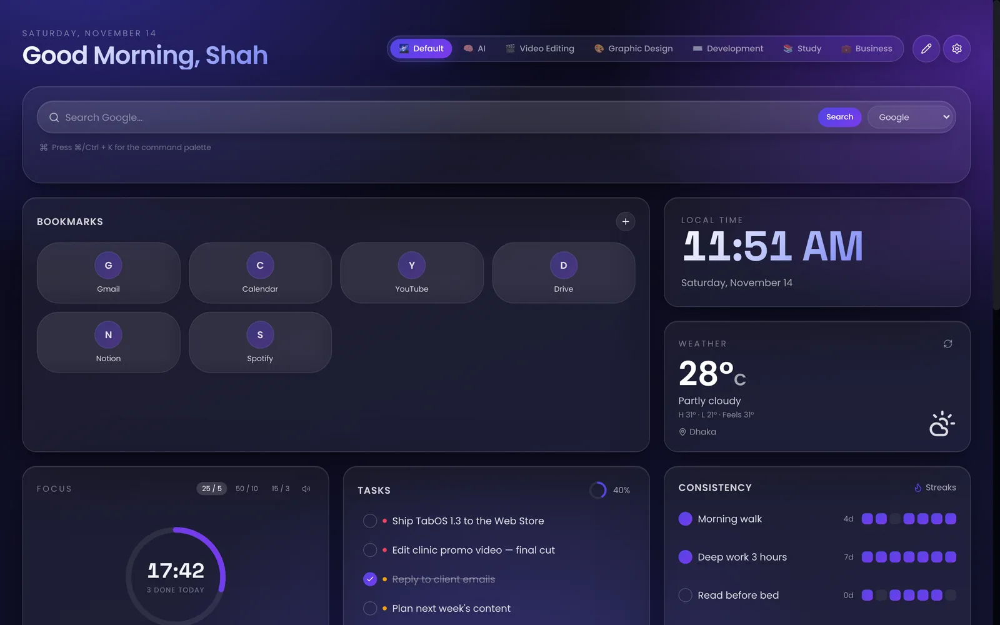
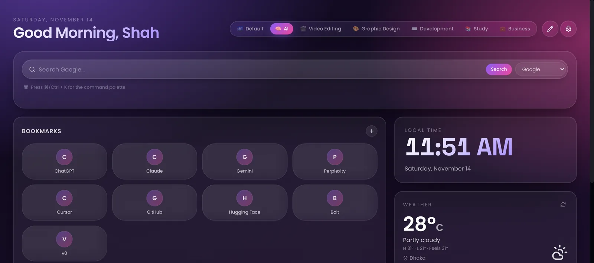
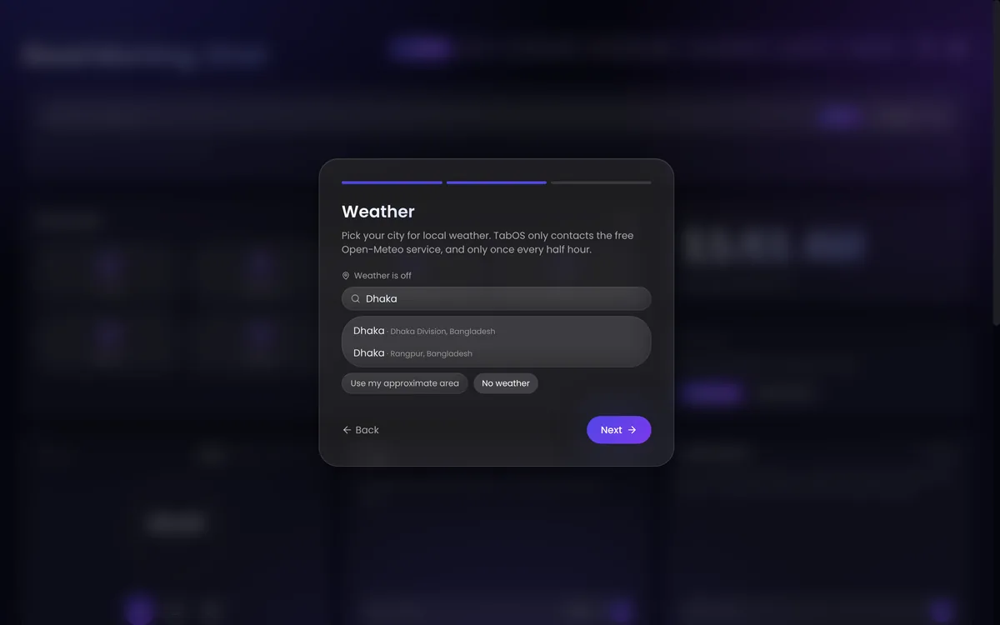
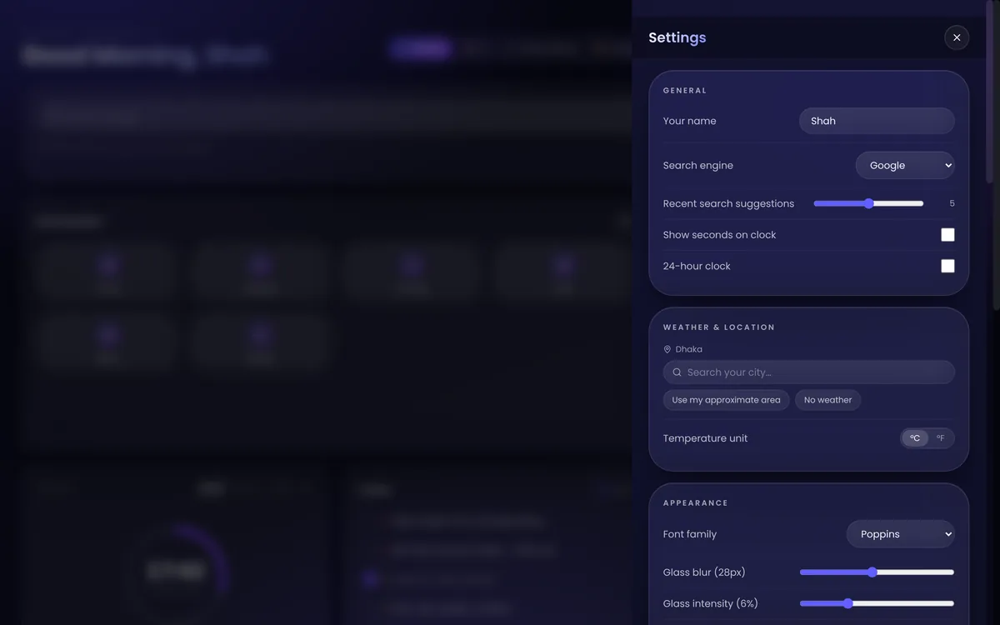

<div align="center">

# TabOS — your new tab, reimagined

**A private, offline-first new tab for Chrome.** Workspaces, bookmarks, tasks, habits, a focus timer, notes and weather — in one glass dashboard you can rearrange.

[](https://chromewebstore.google.com/detail/tabos-%E2%80%94-new-tab-reimagine/ifeekdlkelpelicbchjkafjmknooplgo)
[](https://chromewebstore.google.com/detail/tabos-%E2%80%94-new-tab-reimagine/ifeekdlkelpelicbchjkafjmknooplgo)
[](https://github.com/shahemtiaj/tabos-workspace/releases/latest)


**[Add to Chrome](https://chromewebstore.google.com/detail/tabos-%E2%80%94-new-tab-reimagine/ifeekdlkelpelicbchjkafjmknooplgo)** · **[Download the latest release](https://github.com/shahemtiaj/tabos-workspace/releases/latest)** · **[Privacy policy](public/privacy-policy.html)**



</div>

## Why TabOS

- **No permissions, no accounts, no tracking.** Everything you create stays in your browser. Weather is off until you pick a city.
- **Built for focus.** A real Pomodoro timer with breaks and a chime, tasks with priorities, and daily habit streaks — right where every tab opens.
- **One dashboard per kind of work.** Switch between Default, AI, Video Editing, Graphic Design, Development, Study and Business, each with its own colours and bookmarks, or make your own.
- **Fast.** It appears instantly and works offline.



## Features

| | |
| --- | --- |
| **Workspaces** | Seven ready-made workspaces with their own colours and bookmarks; create, rename, duplicate and delete (with undo). |
| **Bookmarks** | Add, edit and drag to reorder. "Recently opened" and "Most used" show the sites you actually visit. |
| **Focus timer** | 25/5, 50/10 or 15/3 cycles with automatic breaks, a chime, the countdown in the tab title, and a daily session count. Keeps time even when the tab is closed. |
| **Tasks & habits** | Tasks with priorities and a progress ring; habits with streaks and a 13-week heatmap. |
| **Notes** | Notes with clickable links, plus a scratchpad and a read-later list. |
| **Weather** | Search your city once; today's conditions, high, low and "feels like", refreshed every 30 minutes. |
| **Tools** | Scientific calculator, world clocks, countdowns, hydration tracker, daily quote, ambient sounds. |
| **Make it yours** | Resize and hide widgets; adjust blur, glass, corner radius, font, scale and dimming. `Ctrl / ⌘ + K` opens the command palette. |
| **Your data** | Download a backup, restore it on another computer, or erase everything — Settings → Backup. |

<table>
  <tr>
    <td width="50%"></td>
    <td width="50%"></td>
  </tr>
  <tr>
    <td align="center"><sub>A 30-second setup on first install</sub></td>
    <td align="center"><sub>Everything is adjustable in Settings</sub></td>
  </tr>
</table>

## Install

**From the Chrome Web Store:** [Add to Chrome](https://chromewebstore.google.com/detail/tabos-%E2%80%94-new-tab-reimagine/ifeekdlkelpelicbchjkafjmknooplgo).

**From GitHub:**

1. Download `tabos-extension-v<version>.zip` from the [latest release](https://github.com/shahemtiaj/tabos-workspace/releases/latest) and unzip it.
2. Open `chrome://extensions` and turn on **Developer mode**.
3. Click **Load unpacked** and choose the unzipped folder.
4. Open a new tab.

Updating keeps all your data. What changed in each version: [CHANGELOG.md](CHANGELOG.md).

## Privacy

TabOS requests **no Chrome permissions** and collects no analytics. Your data lives in local browser storage, and Settings → Backup downloads it as a file. It only goes online for:

| What | Service | When |
| --- | --- | --- |
| Weather | Open-Meteo | Only after you choose a city or your approximate area; at most every 30 minutes |
| Approximate area | GeoJS | Only if you choose "Use my approximate area"; at most once a day |
| Bookmark icons | Google favicons | For the sites in your bookmarks |
| Search | Your chosen engine | When you search |

Full details: [privacy policy](public/privacy-policy.html).

## Tech stack

| Layer | Choice |
| --- | --- |
| Framework | React 19 + TanStack Start (web) / standalone Vite SPA (extension) |
| Styling | Tailwind CSS v4 with semantic design tokens |
| State | Zustand with persisted stores |
| Animation | Motion for React |
| Extension | Manifest V3, `chrome_url_overrides` only |

## Project structure

```text
src/
  components/
    glass/      Glass primitives (panels, cards)
    shell/      TopBar, command palette, settings, edit mode, tiles
    widgets/    Every dashboard widget
  stores/       Zustand stores (workspace, layout, todos, notes, …)
  lib/          Design tokens, workspace presets, version, utils
  routes/       TanStack Start file-based routes
extension-src/  Standalone MV3 build entry (reuses src/ widgets)
extension/      Built MV3 package (manifest, icons, assets)
scripts/        build-extension.mjs — compiles and zips the release
tests/          e2e.mjs — browser test of the built extension
docs/           screenshots
```

## Development

Requires Node.js 20+ and npm.

```sh
npm install
npm run dev      # web app at http://localhost:8080
npm run build    # production web build
npm run lint
```

## Building the Chrome extension

```sh
npm run build:extension      # or: node scripts/build-extension.mjs
```

This compiles `extension-src/` into a self-contained SPA, writes it into `extension/`, and produces `public/tabos-extension-v<version>.zip`. It runs on any OS (no `zip` tool needed) and stops if `src/lib/version.ts` and `extension/manifest.json` disagree — bump both on release.

### Test in Chrome

```sh
npm i -D playwright
node tests/e2e.mjs            # optional: pass a Chrome / Chromium path
```

Loads the built extension and checks first-run setup, weather caching, bookmarks, the focus timer, backup and restore, upgrades from 1.2.x and that open tabs stay in step. Weather and icon requests are answered locally, so no network is needed.

## License

All rights reserved © [Shah Emtiaj](https://shahemtiaj.com). Built with love in Bangladesh.
